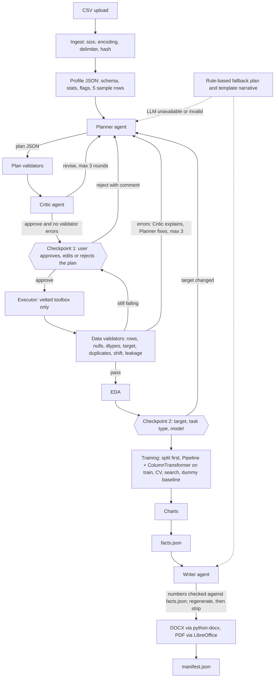

# AutoAnalyst

AutoAnalyst turns a single-table CSV into a validated analysis and a DOCX/PDF report. LLM agents
propose and criticise the cleaning plan and write the narrative, but they never execute code or
decide what runs next: a plain Python state machine runs the steps, a fixed toolbox does the work,
deterministic validators have the final say, and a person approves the plan and the model.

Scope: one CSV table, up to 50 MB / 200,000 rows (configurable), classification or regression.
Time series, multiple tables, text or image modelling, deep learning and user accounts are out of scope.

## How it works



| Component | Where | Notes |
|---|---|---|
| Orchestrator | `autoanalyst/orchestrator/` | Hand-written state machine; state saved to `runs/<job_id>/state.json` after every transition. Long steps run in a thread pool. |
| Ingestion, profiling | `ingest/`, `profiling/` | The profile is all an agent ever sees of the data. |
| Toolbox | `toolbox/` | Cleaning steps (coerce, parse dates, dedupe, drop) run on the full data. Imputation, capping, encoding and scaling are fitted on the training split only. |
| Validators | `validators/` | Plan checks before execution; data checks on a train/holdout dry run after. An agent cannot overrule them. |
| Agents | `agents/` | Planner, Critic (separate, sceptical prompt), Writer. All replies are Pydantic-validated and retried at most twice. Approved plans are cached by data hash + config. |
| LLM | `llm/client.py` | One interface; `hosted` (Gemini), `ollama` (local) or `mock` (offline), chosen in config. |
| Training | `training/`, `models.py` | One model registry for UI and trainer; HistGradientBoosting preselected. |
| Report | `report/`, `viz/` | Greyscale charts, plain Normal-template DOCX, PDF from the same DOCX. |
| UI | `ui/app.py` | Streamlit: upload, plan approval, model choice, report. |

**Why a hand-written state machine and not LangGraph.** The flow is linear with two bounded loops
and two human checkpoints that must survive Streamlit reruns. As an enum, a transition method per
step and a JSON file per job, it is short, fully testable offline and easy to audit. LangGraph would
add a dependency, a checkpointer and an interrupt model to express the same small graph.

## Setup

Requires Python 3.11+ (developed on 3.13), and LibreOffice for the PDF.

```
py -3.13 -m venv .venv
.venv\Scripts\python -m pip install -r requirements.txt
.venv\Scripts\python -m pip install -e .
copy .env.example .env
```

LLM provider (in `.env`):

- `AUTOANALYST_LLM_PROVIDER=hosted` with `GEMINI_API_KEY=...` and `AUTOANALYST_HOSTED_MODEL`
- `AUTOANALYST_LLM_PROVIDER=ollama` after `ollama pull qwen2.5:7b` (fits a 6 GB GPU)
- `AUTOANALYST_LLM_PROVIDER=mock` for offline, deterministic runs

Without a working provider the system still completes every job with the rule-based plan and
the template narrative, and says so in the decision log.

## Use

```
.venv\Scripts\streamlit run autoanalyst/ui/app.py
```

Each job writes to `runs/<job_id>/`: the upload, `state.json`, profile, proposed and approved plan,
debate and fix rounds, validation, EDA, `train_result.json`, `model.joblib`, charts, `facts.json`,
`report.docx`, `report.pdf`, `manifest.json` and `job.log`. Folders older than
`AUTOANALYST_RETENTION_DAYS` (default 7) are removed when the app starts.

The run manifest holds the data hash, seed, configuration (never the API key), library versions,
the plan, the decision log, every agent message and objection, validation results, timings and every
LLM call with its token counts.

## Tests

```
.venv\Scripts\python -m pytest                              # offline, mock LLM
set AUTOANALYST_LIVE=ollama && .venv\Scripts\python -m pytest tests/test_live.py -s
```

Reference datasets are in `tests/data/` (`python tests/data/fetch_datasets.py` downloads them again).

## Evaluation

```
.venv\Scripts\python -m evaluation.run_eval --provider ollama --variants fallback,A,B --writer
.venv\Scripts\python -m evaluation.summarize
```

Six datasets (Iris, Titanic, California Housing, and a corrupted copy of each with nulls,
duplicates, outliers, numbers stored as text, currency symbols, mixed date formats, an identifier
column and a target leak) are planned by three variants: rule-based, A (Planner + validators) and
B (Planner + Critic + validators). Plans are scored against hand-written known-good plans
(`evaluation/gold.py`). Results are in `evaluation/results/results.md`; failure cases found during
development and evaluation are in `docs/failure_cases.md`.

## Configuration

All settings live in `autoanalyst/config.py` and can be overridden in `.env` with the
`AUTOANALYST_` prefix: size limits, seed, validator thresholds, CV folds and search size,
LLM provider, model, temperature, retries, debate and fix-loop limits, LibreOffice path, retention.

## Known limitations

- Rows are split at random. A date column triggers a warning but no time-based split.
- The number checker verifies that each number in the narrative exists in `facts.json`, not that
  it is used correctly (a real F1 called "accuracy" passes), and it cannot check qualitative claims.
- A categorical column that maps one-to-one onto the target is only a validator warning, so a
  leak of that kind depends on the Planner, the Critic or the user to catch it.
- `coerce_numeric` reads `1,234.5` style numbers; European `1.234,5` is parsed wrongly.
- The "beats the baseline" rule (better than the dummy by more than one CV standard deviation and
  on the test set) is a heuristic, not a significance test.
- On a 6 GB GPU, qwen2.5:7b with an 8k context partly runs on the CPU; a run takes minutes.
